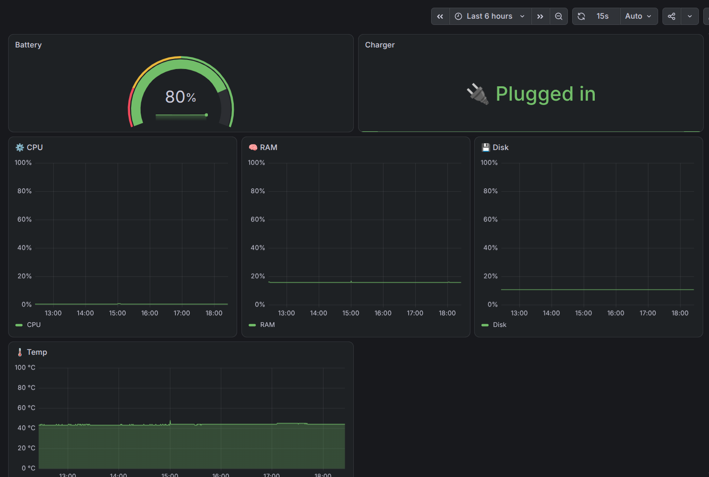

# homelab
Home server setup with Docker and monitoring 🖥️



## Stack
- **Server:** Ubuntu Server 26.04
- **Containers:** Docker, Docker Compose
- **Access:** SSH keys, Tailscale, ufw
- **Monitoring:** Node Exporter → Prometheus → Grafana → Telegram alerts

## Features
- ✅ Grafana dashboard: battery, charger, CPU, RAM, disk, temperature
- ✅ Telegram alerts: power cut, low battery, temperature, CPU, RAM, disk

## Run
Check [monitoring/.env.example](monitoring/.env.example) and set it in your `monitoring/.env`
```bash
cd monitoring
cp .env.example .env
nano .env
docker compose up -d
```
Grafana: `http://<server-ip>:3000`

- **Dashboard:** in Grafana, Dashboards → New → Import → upload `monitoring/dashboards/homelab.json`
- **Alert rules:** `monitoring/alerts/homelab-rules.yaml` (Grafana export, needs a contact point named `Telegram`)
